 

<code>// break it in the lab, prove it with a PoC, fix it in the pipeline //</code>

---

### `0x00` &nbsp;// whoami

---

### `0x01` &nbsp;// recon

---

### `0x02` &nbsp;// kill chain

A pattern I've demonstrated in real engagements (sanitized, no client data). One weak upload form is rarely <i>"just a medium"</i>.

---

### `0x03` &nbsp;// from red to blue

Offense only matters if it ends in a fix. On the AppSec side I decide which scanner alerts are real exploits and which are noise. Real ones get a PoC and a fix, the rest get tuned out with a documented rationale.

---

### `0x04` &nbsp;// breaking the machines that talk

LLM features are just new parsers with an English-shaped attack surface. This is how I threat model LLM/RAG apps.

---

### `0x05` &nbsp;// arsenal

---

### `0x06` &nbsp;// telemetry

  

▲ live: a pixel hacker hunts this week's bugs across my real contribution graph. regenerated every 12h by a GitHub Action.

---

### `0x07` &nbsp;// rules of engagement

---

### `0x08` &nbsp;// capture the flag

Found it? Open an issue titled <code>pwned</code> with <b>only the first 6 characters</b> after <code>BRK{</code>. No spoilers for the next player.
