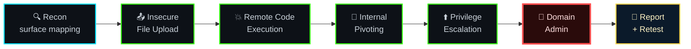
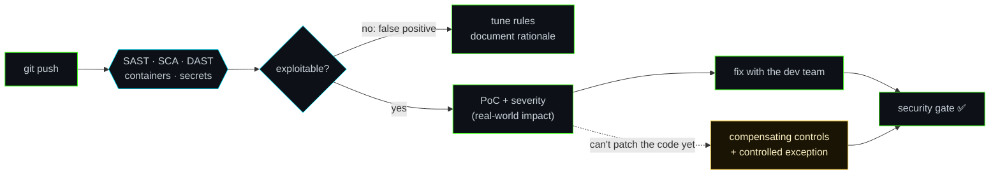

<div align="center">


<br/>


<sub><code>// break it in the lab, prove it with a PoC, fix it in the pipeline //</code></sub>

</div>

---

### `0x00` &nbsp;// whoami

```python
class Operator:
    handle    = "borakove"
    roles     = ["AppSec Engineer", "Penetration Tester", "Security Researcher"]
    path      = "software eng → infrastructure → appsec → offensive security"
    uptime    = "10+ years"
    engaged   = "50+ pentests: web · api · mobile · network · active directory"
    hunting   = ["HackerOne", "Meli Hacking", "Hack The Box"]
    currently = "threat modeling LLM/RAG apps & turning scanner noise into real findings"
    motto     = "if it parses input, it has a bug. find it before they do."
```

---

### `0x01` &nbsp;// recon

```console
$ nmap -sV -p- --script=skills borakove
Starting Nmap 7.95 ( https://nmap.org )
Nmap scan report for borakove (10.13.37.1)
Host is up (0.0001s latency) — always on.

PORT       STATE  SERVICE          VERSION
21/tcp     open   recon            attack-surface mapping · enumeration · OSINT
80/tcp     open   web-pentest      OWASP Top 10 · authN/authZ · business logic · file upload → RCE
88/tcp     open   kerberos         Active Directory · privilege escalation · domain compromise
443/tcp    open   api-security     REST · GraphQL · gRPC · BOLA/BFLA · auth bypass · rate limiting
445/tcp    open   lateral-mvmt     internal pivoting · network & firewall assessment
5555/tcp   open   mobile           mobile application pentest · backend API abuse
8080/tcp   open   appsec-sdlc      secure code review · SAST · DAST · SCA · secrets · security gates
9000/tcp   open   devsecops        Jenkins · GitLab CI · GitHub Actions · CheckmarxOne · Acunetix
11434/tcp  open   llm-redteam      prompt injection · RAG data leakage · insecure output handling
31337/tcp  open   elite            reverse engineering · binary exploitation · CTFs

OS details: Linux (Ubuntu) · Windows (PowerShell) · polyglot: Python C# Java JavaScript SQL Bash
Service Info: Mindset: assume-breach; Output: reproducible PoC + practical fix

Nmap done: 1 IP address (1 host up) scanned — 0 ports filtered, curiosity unbounded.
```

---

### `0x02` &nbsp;// kill chain

> A pattern I've demonstrated in real engagements (sanitized, no client data). One weak upload form is rarely "just a medium".



---

### `0x03` &nbsp;// from red to blue

Offense only matters if it ends in a fix. On the AppSec side, I'm the person who decides whether a SAST alert is a real exploit or noise:



---

### `0x04` &nbsp;// breaking the machines that talk

LLM features are just new parsers with an English-shaped attack surface. How I threat model LLM/RAG apps:

| Threat | How it lands | What actually stops it |
|:--|:--|:--|
| 🧨 **Prompt injection** (direct & indirect) | user input, poisoned docs in the RAG index, tool output | treat all retrieved content as data; privilege separation between instructions and context |
| 🕳️ **Data leakage** | retrieval ignores who is asking | enforce document-level ACLs **at retrieval time**, not in the prompt |
| 🧪 **Insecure output handling** | model output rendered as HTML, SQL or shell | the model's output is untrusted input: encode, validate, sandbox |
| 🔑 **Broken authorization** | agents and tools running with service-account power | least-privilege tools, propagate the end-user's identity |

---

### `0x05` &nbsp;// arsenal

<p>


</p>

<p>


</p>

<p>


</p>

<p>


</p>

**Playbooks:** `PTES` · `OWASP WSTG / ASVS` · `OWASP API Top 10` · `MITRE ATT&CK` · `STRIDE`<br/>
**Training:** APIsec University track: API Security Architect, OWASP API Top 10, API Gateway Security, PCI API Security, API Security in DevSecOps

---

### `0x06` &nbsp;// telemetry

<div align="center">


<br/><br/>


<sub>▲ live: a pixel hacker hunts this week's bugs across my real contribution graph. regenerated every 12h by a GitHub Action.</sub>

</div>

---

### `0x07` &nbsp;// rules of engagement

```diff
+ authorized scope only. scope is law.
+ evidence over assumptions: every finding ships with a reproducible PoC
+ exploitability over CVSS theater
+ a finding without a fix is just a complaint
+ responsible disclosure, always
- no unauthorized testing. no exceptions.
```

---

### `0x08` &nbsp;// capture the flag 🏴

There's a flag hidden somewhere in this repository.

```
format : BRK{...}
hint 1 : recon is half the battle. what you see is not all that's served.
hint 2 : two layers. one of them is older than computers.
```

<sub>Found it? Open an issue titled <code>pwned</code> with <b>only the first 6 characters</b> after <code>BRK{</code>. No spoilers for the next player.</sub>

<div align="center">

<br/>

```
[ connection closed by foreign host ]
```

</div>
